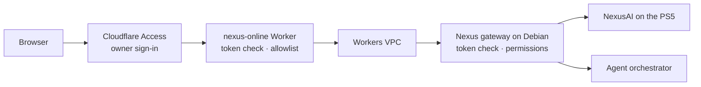

<div align="center">


# Nexus Online

**The browser client for the Nexus ecosystem.**<br>
A public landing page, the Nexus docs and an owner-only web app, served by one Cloudflare Worker.

[](https://nexus.liamjc.dev)
[](https://astro.build)
[](DEPLOY.md)
[](worker/worker.test.mjs)

[**nexus.liamjc.dev**](https://nexus.liamjc.dev) ·
[Docs](https://nexus.liamjc.dev/docs/) ·
[Nexus ecosystem](https://github.com/ljcatherine/Nexus) ·
[Deploy](DEPLOY.md) ·
[Security](#how-it-is-secured)

</div>

---

## What's in it

<table>
<tr>
<td width="33%" valign="top">

### 🌐 Landing page
**`/`** · public

The orbit hero, a pinned scroll tour of the clients, the "how it fits"
diagram and the security model. Animations are on by default, with a
toggle in the footer.

</td>
<td width="33%" valign="top">

### 📖 Docs
**`/docs`** · public

The full Nexus setup guides, synced from
[`ljcatherine/Nexus`](https://github.com/ljcatherine/Nexus) with
`npm run docs`. Links point at site pages and simple flowcharts become
step diagrams.

</td>
<td width="33%" valign="top">

### 🔒 Web app
**`/app`** · owner only

NexusAI status and chat, read-only workspace files on Debian and NixOS,
PS5 models, agent runs and a security page, behind Cloudflare Access.

</td>
</tr>
</table>

## The Nexus apps

| App | Platform | Repository |
|---|---|---|
| NexusiOS | iPhone · Swift | [ljcatherine/NexusiOS](https://github.com/ljcatherine/NexusiOS) |
| NexusNix | NixOS · Rust | [ljcatherine/NexusNix](https://github.com/ljcatherine/NexusNix) |
| NexusWindows | Windows · Rust | [ljcatherine/NexusWindows](https://github.com/ljcatherine/NexusWindows) |
| **Nexus Online** | Web · Astro and Workers | this repository |

Setup for the whole ecosystem: [nexus.liamjc.dev/docs](https://nexus.liamjc.dev/docs/).

## How it is secured



| Layer | What it does | Where |
|---|---|---|
| **Cloudflare Access** | Guards `/app` and `/api`. It's the same Access application as the `nexus-gateway` Worker, so the gateway accepts its tokens. | Zero Trust dashboard |
| **Token check** | Verifies every Access token itself: RS256 signature, issuer, audience, expiry and owner email. Missing settings fail closed with 401. | [`worker/access.js`](worker/access.js) |
| **Route allowlist** | Mirrors Nexus Desktop's gateway classifier. Only read and inference routes pass; writes, model load/unload, agent runs, patches, commands and the SSH relay are refused before the gateway. | [`worker/routes.js`](worker/routes.js) |
| **Request checks** | Posts must be same-origin JSON within a size limit. Workspace paths are validated. Only the Access assertion is forwarded, never cookies. | [`worker/index.js`](worker/index.js) |
| **Headers** | Strict CSP with no inline scripts, `frame-ancestors 'none'`, HSTS, `no-store` behind sign-in. | [`worker/index.js`](worker/index.js) |
| **Browser** | Gateway data is rendered as text, never HTML. Chats stay in `sessionStorage` unless you keep them. Files that usually hold secrets are never sent to the AI. | [`src/app/`](src/app) |

> [!IMPORTANT]
> The web app can't write anything. SSH terminals, host metrics, the editor and Codex/Claude Code stay
> in Nexus Desktop; model loading and agent runs stay in NexusiOS.

## Develop

> [!NOTE]
> Needs Node 22 or newer.

```bash
npm install
npm test                                  # Worker security tests
npm run build && npm run preview:worker   # real Worker on :8788, sample data, signed in
```

`SIGNED_OUT=1 npm run preview:worker` shows the sign-in page. `npm run dev` serves only the pages,
without the Worker. `npm run docs` pulls the latest docs from `ljcatherine/Nexus`.

## Deploy

Copy `wrangler.example.jsonc` to the git-ignored `wrangler.jsonc`, fill in the hostname, Access team
domain, AUD tag, owner email and VPC service ID, then:

```bash
npm run deploy   # tests, build, deploy
```

The full walkthrough is in [DEPLOY.md](DEPLOY.md) and the
[Nexus Online guide](https://nexus.liamjc.dev/docs/apps/online/).

## Project layout

<details>
<summary><b>Files</b></summary>

| Path | What it holds |
|---|---|
| [`src/pages/index.astro`](src/pages/index.astro) | Landing page |
| [`src/pages/docs/[...slug].astro`](src/pages/docs/[...slug].astro) | Docs pages, sidebar, step diagrams |
| [`src/docs/`](src/docs) | Copy of the Nexus docs |
| [`src/pages/app/index.astro`](src/pages/app/index.astro), [`src/app/`](src/app) | Web app shell and screens |
| [`src/layouts/Base.astro`](src/layouts/Base.astro), [`src/styles/global.css`](src/styles/global.css) | Shared layout and Midnight Liquid Glass styles |
| [`src/lib/docs.mjs`](src/lib/docs.mjs), [`scripts/sync-docs.mjs`](scripts/sync-docs.mjs) | Docs routing and sync |
| [`worker/`](worker) | Cloudflare Worker, Access verification, route allowlist, tests |
| [`scripts/preview.mjs`](scripts/preview.mjs) | Local preview of the real Worker with sample data |
| [`mockups/`](mockups) | Original design concept |

</details>

<details>
<summary><b>Known issues</b></summary>

- `/v1/models` and `/v1/context` return 502 from the gateway against NexusAI v0.8.3 while chat works.
  The chat model picker falls back to the PS5's loaded model, and the context meter stays blank.
- Synced iPhone conversations return 403: the gateway doesn't grant the web sign-in conversation history.

</details>

<div align="center">
<sub>Part of <a href="https://github.com/ljcatherine/Nexus">Nexus</a> · <a href="https://nexus.liamjc.dev">nexus.liamjc.dev</a></sub>
</div>
