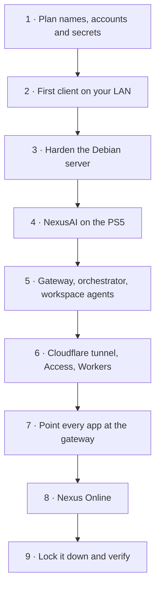

# Setting up the whole ecosystem

This walks through a full Nexus deployment in the order things depend on each
other. Each stage works on its own, so you can stop at any point and still have
something useful.

## 1. Plan

Write these down somewhere private (a password manager), never in a repository:

| Item | Example | Used by |
|---|---|---|
| Debian SSH account | `server` | SSH, hardening, `nexus-ro` |
| Workstation SSH account | `user` | SSH, relay alias `nixos` |
| Owner email | `you@example.com` | Access policy, gateway permissions |
| Access team | `your-team.cloudflareaccess.com` | Every client, gateway |
| Worker host | `nexus-gateway..workers.dev` | Apps, Access application |
| Web hostname | `nexus.example.com` | Nexus Online |
| PS5 address | a fixed DHCP lease on your LAN | Gateway, orchestrator |

Secrets you'll generate (each one different, from `openssl rand -hex 32`):
the PS5 control token, the orchestrator token, one workspace-agent token per
host, the conversation-sync key, and the tunnel token from Cloudflare.

## 2. Start with one client on your LAN

Install any client ([iPhone](/docs/apps/ios/), [Linux](/docs/apps/linux/),
[Windows](/docs/apps/windows/)) and add your servers by LAN or Tailscale address.
Create or import an Ed25519 key, install the public half with
`install-verified-ssh-key.sh`, and confirm each host fingerprint on first connect.

You now have SSH, files, services and host health with no backend at all.

## 3. Harden the Debian server

Follow [Debian steps 1–3](/docs/backend/debian/#1-base-system): Tailscale, key-only
SSH, the `nexus_hardening` firewall with its 5-minute automatic rollback, and the
`nexus-gateway` service account.

## 4. Add NexusAI on the PS5

Follow [NexusAI](/docs/backend/nexusai/): back up the original NexusAI title and
state, install the NexusAI PS5 app under its own title ID with `0755` executables,
and check `:8081/v1/models` from the Debian server. Enable the `:8082` control API
later, once the firewall allows only Debian to reach it.

Every client can already chat with `http://<ps5-address>:8081/v1` on the LAN.

## 5. Install the Debian services

Follow [Debian steps 4–8](/docs/backend/debian/#4-gateway):

1. **Gateway**: binary, unit, `nexus.env` with the Access values left as
   placeholders for now. It won't start until they're real, which is expected.
2. **SSH relay keys** for the `nixos` and `debian` aliases.
3. **Agent orchestrator** as a user service, sharing its token with the gateway.
4. **Workspace agents** on Debian and the workstation, each with its own token and roots.
5. **`nexus-ro`** as a forced command for the Desktop key.

## 6. Connect Cloudflare

Follow [Cloudflare steps 2–5](/docs/backend/cloudflare/#2-tunnel-and-workers-vpc):

1. Create the tunnel and start `nexus-cloudflared` on Debian.
2. Create the VPC service for `127.0.0.1:8787`.
3. Deploy the `nexus-gateway` Worker with that service ID.
4. Create the Access application for the Worker host, with your email, MFA and Managed OAuth.
5. Register the public OAuth client.
6. Set `ACCESS_AUDIENCE` and `OWNER_EMAIL` on the Worker.
7. Put the issuer, AUD tag and JWKS URL in `nexus.env`, grant your email its
   permissions, and restart the gateway. It starts now.

## 7. Point every app at the gateway

Give each app the Worker host, Access issuer and client ID
([Configuration](/docs/configuration/)):

- **iPhone**: `local/deployment.plist` at build time, or Settings → API Connections.
- **Linux**: `~/.config/nexus-desktop/site.json` or the NixOS module.
- **Windows**: the values in `crates/nexus-access`.

Sign in once from each. Then try a relay SSH profile, and on the iPhone, PS5 model
switching and an agent run.

Pair the desktop app locks: Nexus Desktop → Settings → App lock → **Set up with
iPhone**, then type the key into iPhone → Services → One Time Passcode.

## 8. Add Nexus Online

Follow [Cloudflare step 6](/docs/backend/cloudflare/#6-nexus-online-worker): add the
`/app` and `/api` paths of your web hostname to the same Access application, then
deploy the `nexus-online` Worker with the same VPC service ID.

## 9. Lock it down and verify

| Check | How |
|---|---|
| No public ports | `ss -tlnp` on Debian shows only loopback for 8787, 8896 and 8897; the router has no forwards |
| Access is owner-only | A second account is refused at `/app` and in the apps |
| Workers fail closed | Unset `OWNER_EMAIL` briefly: everything returns 401/403 |
| Debian is read-only to Desktop | A write attempt from Desktop is denied and audited |
| Web is read-only | `POST /api/v1/nexus/models/unload` returns 403 |
| Host keys are pinned | Changing a server's host key makes every app refuse it |
| PS5 control is private | `:8082` is unreachable from anything but Debian |
| Rate limits | WAF rule on `/api/*` and `/v1/*` |

Then add the hardening from [Cloudflare step 8](/docs/backend/cloudflare/#8-hardening-and-recovery)
and keep the rollback commands handy.
